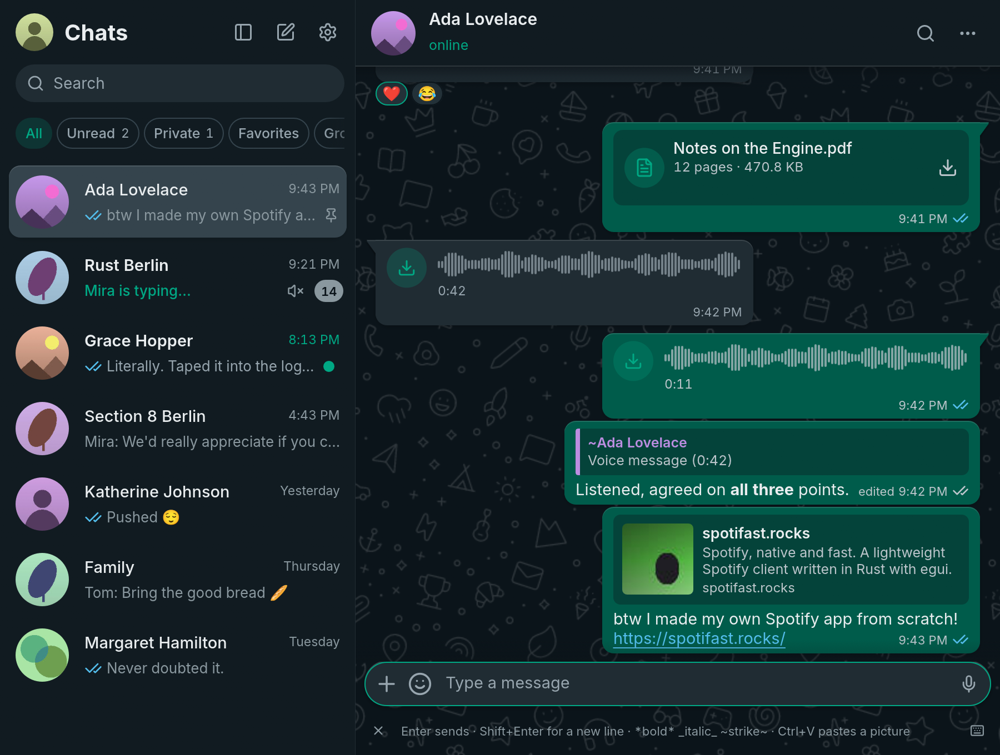

  

<h1 align="center">ZapFast</h1>

<strong>WhatsApp, native and fast.</strong> A lightweight WhatsApp app for Linux, macOS, and Windows.

  <a href="../../releases"><strong>Download</strong></a> ·
  <a href="../../releases">Getting started</a>

  
  
  

ZapFast is a WhatsApp client written in Rust with
[egui](https://www.egui.rs) and [fastframe](https://fastframe.dev), the
framework behind a family of native desktop apps.

The interface is available in English, Chinese (Simplified and Traditional),
Dutch, French, German, Indonesian, Italian, Portuguese (Brazil), Russian,
Spanish, and Turkish.

<picture>
  <source media="(prefers-color-scheme: light)" srcset="docs/screenshot-light.png">
  
</picture>

<strong>Watch ZapFast in action</strong>

https://github.com/user-attachments/assets/2bf86b54-45fc-4add-8de7-c426c3cdad9b

[Features](#your-chats-on-your-desktop) · [Install](#install) · [Link your phone](#link-your-phone) · [Help](#guides-and-help)

## Your chats, on your desktop

| Feature | What you can do |
|---|---|
| **Messages** | Send formatted text, replies, edits, reactions, forwards, pictures, files, stickers, GIFs, polls, and voice messages. |
| **Media in the chat** | Play voice messages, videos, round video messages, GIFs, and animated stickers in place. |
| **Your history** | Keep your chats in an encrypted archive on this computer, fetch older messages from your phone as you scroll, and export locally saved chat history as text or a ZIP with downloaded attachments. |
| **Several numbers** | Link more than one WhatsApp number and switch between them in one window. |
| **Desktop controls** | Use keyboard shortcuts, select and copy text across messages, and stay linked in the tray with notifications. |
| **Themes** | Choose light, dark, system appearance, or custom colours. On Omarchy, follow your desktop theme. |
| **Privacy** | Hide locked chats behind a code, or the whole window behind an app lock. Nothing goes to a server of ours. |

## Install

[View all releases](../../releases)

| Platform | Download | Run |
|----------|----------|-----|
| **Windows x64** | [zapfast-x64.7z](../../releases) | Run installer → launch `zapfast-x64.7z` |
| **Linux x64** | [zapfast-Linux-x64.run](../../releases) | `chmod +x` → run installer |
| **macOS Apple Silicon** | [zapfast-macOS-arm64.dmg](../../releases) | Open DMG → drag to Applications |

## Link your phone

1. Open ZapFast. It shows a QR code.
2. On your phone, open WhatsApp, then **Settings**, **Linked devices**,
   **Link a device**, and scan the code. Or click **Link with phone number**
   and enter the eight-character code on your phone.
3. Your recent chats arrive from the phone. Older messages follow as you
   scroll up.

The link survives restarts, and your phone does not need to stay online to
read what ZapFast has already stored. 

## License

ZapFast is an unofficial client and is not affiliated with WhatsApp or Meta.
Using an unofficial client may be against WhatsApp's terms of service and
could get an account suspended. Use it at your own risk. WhatsApp is a
trademark of WhatsApp LLC.

Licensed under the [MIT License](LICENSE).

## Star history

<a href="https://www.star-history.com/?repos=crmne%2Fzapfast&amp;type=date">
  <picture>
    <source media="(prefers-color-scheme: dark)" srcset="https://api.star-history.com/chart?repos=crmne/zapfast&amp;type=date&amp;theme=dark">
    
  </picture>
</a>
